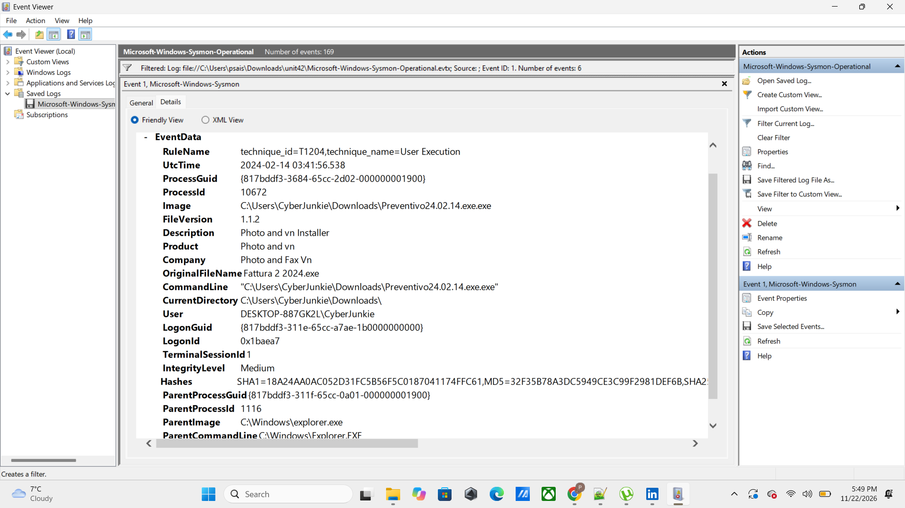
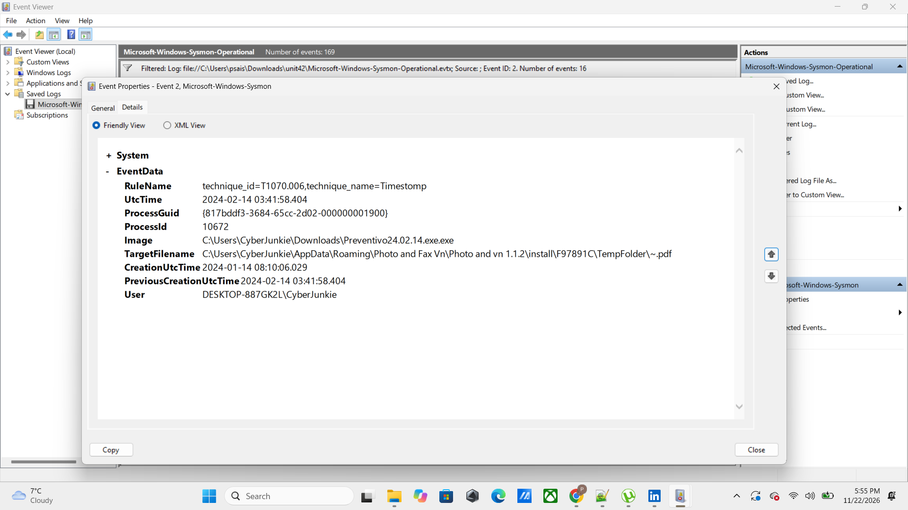
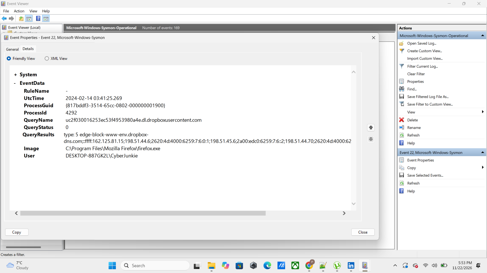
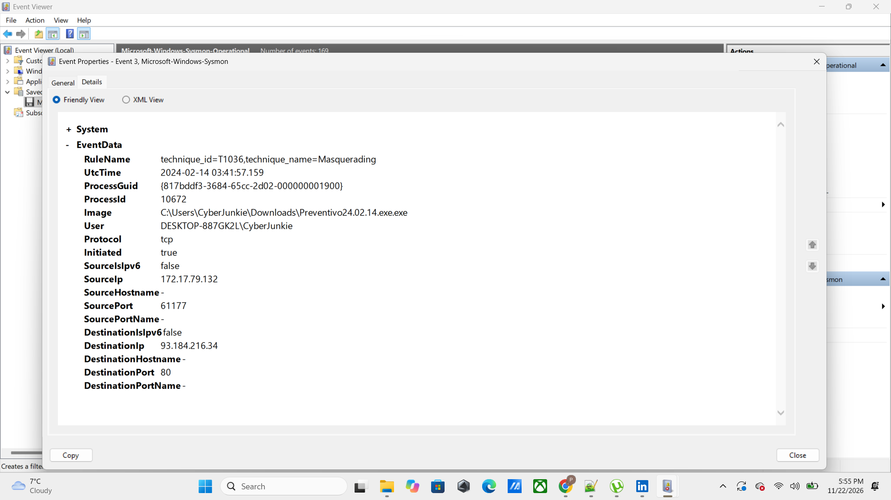
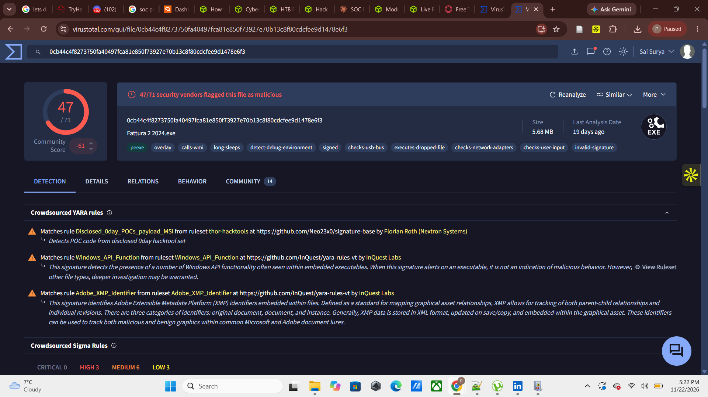

# HTB Sherlock: Unit42 – Backdoored UltraVNC Initial Access (Sysmon Analysis)

| Field | Value |
|---|---|
| Platform | Hack The Box – Sherlocks (DFIR, Very Easy) |
| Category | Windows Endpoint / Malware Execution |
| Evidence | `Microsoft-Windows-Sysmon-Operational.evtx` |
| Tools | Windows Event Viewer, VirusTotal |
| Host / User | `DESKTOP-887GK2L` / `CyberJunkie` |
| Verdict | **True Positive**: malware executed by the user |
| Severity | High |

## 1. Summary
A user downloaded a malicious executable (`Preventivo24.02.14.exe.exe`) from Dropbox using Firefox and ran it. The malware used `msiexec.exe` to install files under `AppData\Roaming`, dropped a script (`once.cmd`), and timestomped files so they would look older. It then queried a dummy domain to check for internet access before terminating. VirusTotal flags the dropper 47/71 as `trojan.winvnc/based`. The activity matches the initial access stage of a campaign, reported by Palo Alto Unit 42, that uses a backdoored version of UltraVNC to keep remote access.

**Root cause:** the user ran an untrusted executable downloaded from a cloud file-sharing service. The double `.exe.exe` extension suggests the file was disguised to look like a document.

## 2. Scenario
I was given Sysmon logs from a compromised Windows machine and asked to identify the malicious process, how it was delivered, and what it did on the host.

## 3. Investigation Steps

| # | What I checked | Sysmon Event ID | Finding |
|---|---|---|---|
| 1 | Overview of file creation activity | 11 (File Created) | 56 file-creation events in total |
| 2 | All process executions, grouped by parent process | 1 (Process Create) | 6 events. One suspicious chain: `explorer.exe` → `Preventivo24.02.14.exe.exe` → `msiexec.exe` |
| 3 | Ruled out benign activity | 1 | `firefox.exe` → `pingsender.exe` is normal Firefox telemetry |
| 4 | How the file reached the host | 22 (DNS Query) | `firefox.exe` queried Dropbox download domains just before the malware appeared, so the delivery was via Dropbox |
| 5 | Defence evasion | 2 (File Creation Time Changed) | 16 timestomping events by the malware. A dropped PDF's creation time was changed from `2024-02-14 03:41:58` to `2024-01-14 08:10:06` (backdated one month) |
| 6 | Files dropped on disk | 11 | `once.cmd` created under the malware's install folder in `AppData\Roaming` |
| 7 | Network activity | 22, 3 (Network Connection) | The malware queried `www.example.com` and connected to `93.184.216.34:80`. This looks like an internet connectivity check rather than C2 |
| 8 | Installation chain | 1 | `services.exe` → `msiexec.exe` → two `SysWOW64\msiexec.exe` children, consistent with the Windows Installer service carrying out a malicious MSI install |
| 9 | Threat intelligence on the dropper's SHA256 | VirusTotal | 47/71 detections, label `trojan.winvnc/based`, categories trojan / hacktool / PUA. This confirms the behavioural verdict and links the sample to the UltraVNC campaign |
| 10 | Process termination | 5 (Process Terminated) | Malware terminated itself at 03:41:58.795, less than a second after dropping `once.cmd` |

### Process tree (Event ID 1)
```
explorer.exe (1116)
└── C:\Users\CyberJunkie\Downloads\Preventivo24.02.14.exe.exe (10672)   ← malicious
    └── C:\Windows\SysWOW64\msiexec.exe (10324)

services.exe (740)
└── C:\Windows\System32\msiexec.exe (10220)
    ├── C:\Windows\SysWOW64\msiexec.exe (6996)
    └── C:\Windows\SysWOW64\msiexec.exe (10280)

firefox.exe (4292)
└── pingsender.exe (5584)   ← benign
```



### Key evidence
**Timestomping (Event ID 2)**
```
Image:                   C:\Users\CyberJunkie\Downloads\Preventivo24.02.14.exe.exe
TargetFilename:          C:\Users\CyberJunkie\AppData\Roaming\Photo and Fax Vn\Photo and vn 1.1.2\install\F97891C\TempFolder\~.pdf
CreationUtcTime:         2024-01-14 08:10:06.029   (tampered)
PreviousCreationUtcTime: 2024-02-14 03:41:58.404   (original)
```



**Dropped script (Event ID 11)**
```
UtcTime:        2024-02-14 03:41:58.404
Image:          C:\Users\CyberJunkie\Downloads\Preventivo24.02.14.exe.exe
TargetFilename: C:\Users\CyberJunkie\AppData\Roaming\Photo and Fax Vn\Photo and vn 1.1.2\install\F97891C\WindowsVolume\Games\once.cmd
```

**Delivery via Dropbox (Event ID 22)**



**Connectivity check (Event ID 3)**



**Threat intelligence (VirusTotal)**



## 4. Indicators of Compromise (defanged)

| Type | Value | Notes |
|---|---|---|
| File | `Preventivo24.02.14.exe.exe` | Malicious dropper, double extension |
| SHA256 | `0CB44C4F8273750FA40497FCA81E850F73927E70B13C8F80CDCFEE9D1478E6F3` | Malicious dropper; VirusTotal: 47/71, label `trojan.winvnc/based` (families: winvnc, ultravnc) |
| SHA1 | `18A24AA0AC052D31FC5B56F5C0187041174FFC61` | |
| MD5 | `32F35B78A3DC5949CE3C99F2981DEF6B` | |
| IMPHASH | `36ACA8EDDDB161C588FCF5AFDC1AD9FA` | Useful for finding related samples |
| Domain | `uc2f030016253ec53f4953980a4e.dl.dropboxusercontent[.]com` | Malware download source |
| Domain | `d.dropbox[.]com` | Dropbox |
| File | `...\WindowsVolume\Games\once.cmd` | Dropped script |
| Directory | `%APPDATA%\Photo and Fax Vn\` | Malware install location |
| Domain / IP | `www.example[.]com` / `93.184.216[.]34:80` | Connectivity check (not malicious in itself) |

## 5. MITRE ATT&CK Mapping

| Tactic | Technique | ID | Evidence |
|---|---|---|---|
| Execution | User Execution: Malicious File | T1204.002 | User launched the file from Downloads via `explorer.exe` |
| Defence Evasion | Masquerading: Double File Extension | T1036.007 | `.exe.exe` filename |
| Defence Evasion | System Binary Proxy Execution: Msiexec | T1218.007 | Malware spawned `msiexec.exe` |
| Defence Evasion | Indicator Removal: Timestomp | T1070.006 | 16 Event ID 2 entries |
| Command and Control | Ingress Tool Transfer | T1105 | Payload pulled from Dropbox |
| Discovery | System Network Configuration Discovery: Internet Connection Discovery | T1016.001 | DNS lookup and connection to `example.com` |

## 6. Timeline (UTC, 2024-02-14)

| Time | Event |
|---|---|
| 03:41:45.924 | `firefox.exe` resolves Dropbox download domains (Event ID 22) |
| 03:41:56.538 | User runs `Preventivo24.02.14.exe.exe` from Downloads (Event ID 1) |
| 03:41:56.955 | Malware queries `www.example.com`, an internet connectivity check (Event ID 22) |
| 03:41:57.159 | Malware connects to `93.184.216.34:80` (Event ID 3) |
| 03:41:57.787 | Malware spawns `SysWOW64\msiexec.exe`, and installation begins (Event ID 1) |
| 03:41:58.404 | `once.cmd` and other files dropped in `AppData\Roaming`; `~.pdf` timestomped to 2024-01-14 (Event IDs 11, 2) |
| 03:41:58.795 | Malware process terminates (Event ID 5) |

**Observation:** the whole chain, from execution to termination, took about **2.3 seconds**. The malware checked for internet access *before* installing, which suggests it only goes ahead when it's online. The download-to-execution gap of about 11 seconds is consistent with the user downloading the file and opening it straight away.

## 7. Response / Recommendations
- Isolate `DESKTOP-887GK2L` from the network.
- Remove `%APPDATA%\Photo and Fax Vn\` and check for persistence (Run keys, scheduled tasks, services) and any UltraVNC components.
- Block the IOCs, and hunt for the file hash and the Dropbox URL across other endpoints.
- Reset `CyberJunkie`'s credentials and review recent logons.
- Longer term: alert on `msiexec.exe` spawned from user-writable folders and on files with double extensions. Consider restricting execution from `Downloads` and `AppData`. Run user awareness training on downloaded files.

## 8. Lessons Learned
- Grouping Event ID 1 by **parent process** quickly separated normal activity (Firefox telemetry) from the malicious chain.
- Event ID 2 is easy to overlook, but it exposes timestomping that would otherwise defeat a timeline built on file timestamps.
- Not every outbound connection is C2. Context (`example.com` with no follow-up activity) pointed to a connectivity check.
- **Detection idea:** alert when a process running from `\Downloads\` or `\AppData\` spawns `msiexec.exe`, or produces Event ID 2 activity.
